# CoraByte Payroll

**Payroll for Indonesian payroll consultants, from employee master data to bank transfer file, in one
self-contained app.** PPh 21 (TER) and BPJS are calculated on the server, payslips come out as PDF, and
the Bank Mandiri payroll CSV is ready to upload. **Multi-tenant**: one login belongs to one organisation
(the employer), with its own isolated employees, payroll and users. It runs on Node.js and its built-in
SQLite, with **zero npm dependencies**.


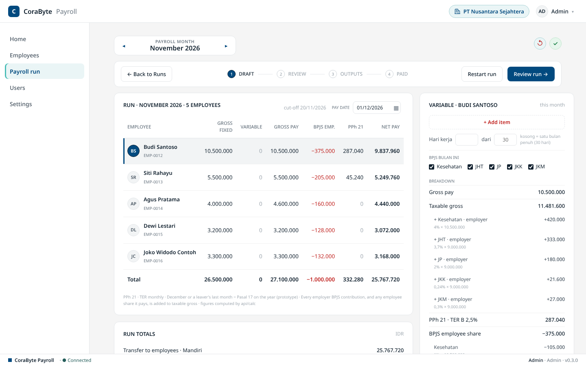

## Why this exists

A payroll consultant runs payroll for several client companies every month. Each client has its own
JKK risk class, pay day, cut-off and debit account; each employee has a PTKP status, a contract type
and salary components that change over time. Since 2024 the monthly PPh 21 uses the **TER** tables
(daily-paid workers have their own), with a full **Pasal 17** reconciliation in December, and BPJS
has wage floors and caps per programme. Doing this in spreadsheets means copying formulas between
clients, re-checking every month, and hand-typing bank files. A wrong digit costs someone their salary.

CoraByte Payroll turns that into one guided flow per client per month:

**Draft** (the server calculates every line) → **Review** (each employee is checked and signed off) →
**Outputs** (payslips, remittance summary, bank file) → **Paid** (the run is frozen and kept as history).

## Highlights

- **Calculation you can trust.** The engine (`src/calc/engine.js`) is pure functions with a built-in
  self-test. It covers PPh 21 TER (monthly and daily), the December Pasal 17 reconciliation, BPJS
  Kesehatan / JHT / JP / JKK / JKM with floors and caps, THR runs and opening balances for mid-year
  joiners. When no rate is in force it refuses rather than guesses.
- **Multi-tenant by design.** Each organisation (one employer) registers itself and gets its own
  employees, runs and users. Every query is bound to the signed-in user's organisation at the
  repository layer (`documents.forOrg(orgId)`), so one tenant cannot read or write another's rows,
  and tests prove it.
- **One gate for every write.** Screens and the calculation both write through `store-service.js`,
  which enforces the business rules on the server:
  - optimistic locking (`rev`);
  - the run status flow, where a run reaches outputs only when every line is reviewed;
  - one live run per client, month and type;
  - paid runs are immutable;
  - deletes are admin-only;
  - every step is written to an audit log.
- **Zero dependencies.** Everything comes from the Node.js standard library: HTTP (`node:http`),
  the database (`node:sqlite`), password hashing (`node:crypto` scrypt) and tests (`node:test`).
  Nothing to `npm install`, nothing to patch.
- **Works offline.** Fonts and the PDF libraries are self-hosted. The database lives outside the
  project folder, so cloud-synced folders never corrupt it.
- **Secure defaults.** Session tokens are stored only as SHA-256 hashes in HTTP-only cookies.
  Cross-site POSTs are refused, repeated failed sign-ins are rate-limited, the server binds to
  localhost by default, and NIK, NPWP and bank account numbers are masked in the UI and never logged.
- **Tested.** `npm test` covers authentication and roles, tenant isolation, the database upgrade,
  and a full payroll lifecycle with exact expected totals.

## Screenshots

| | |
|---|---|
| 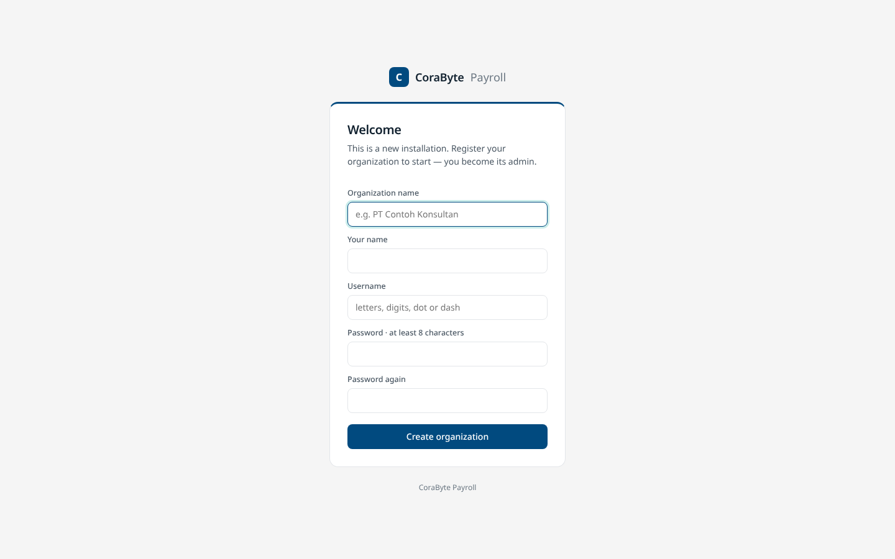 | 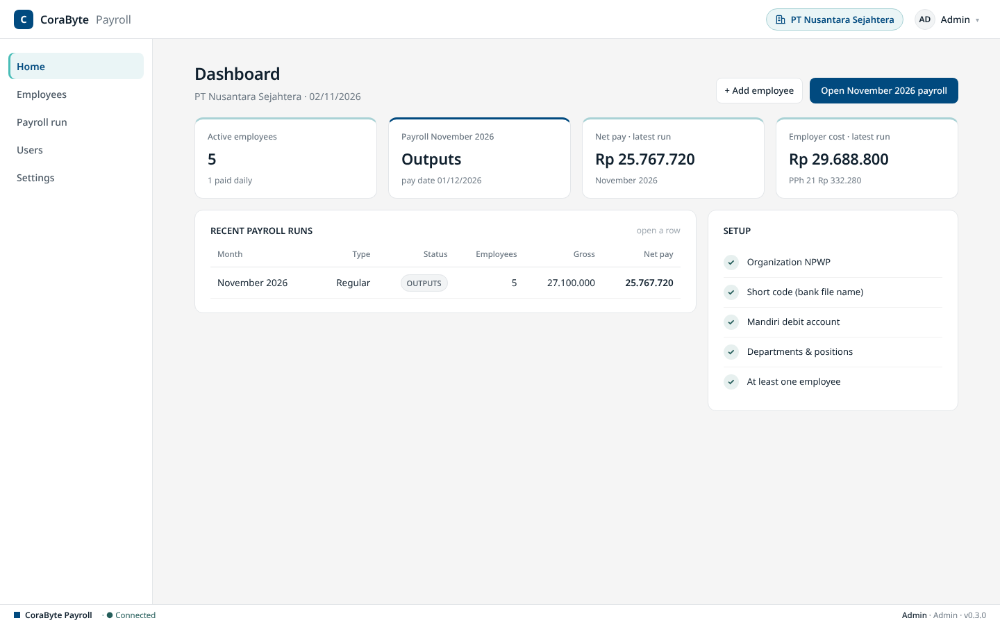 |
| **Register.** One organisation = one employer, with its first admin. | **Home.** Dashboard: headcount, this month's payroll, latest totals, setup. |
| 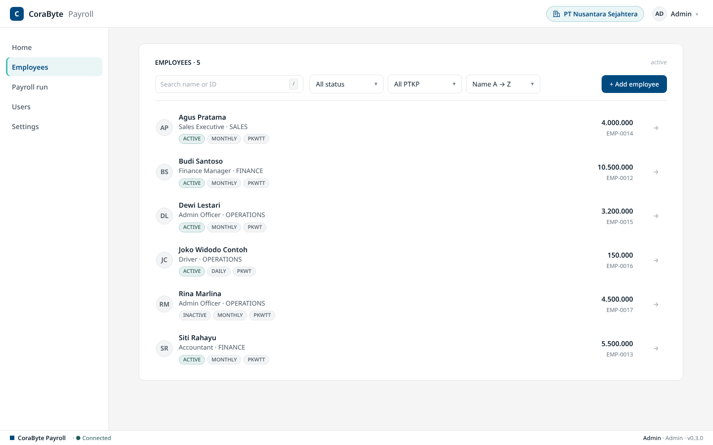 | 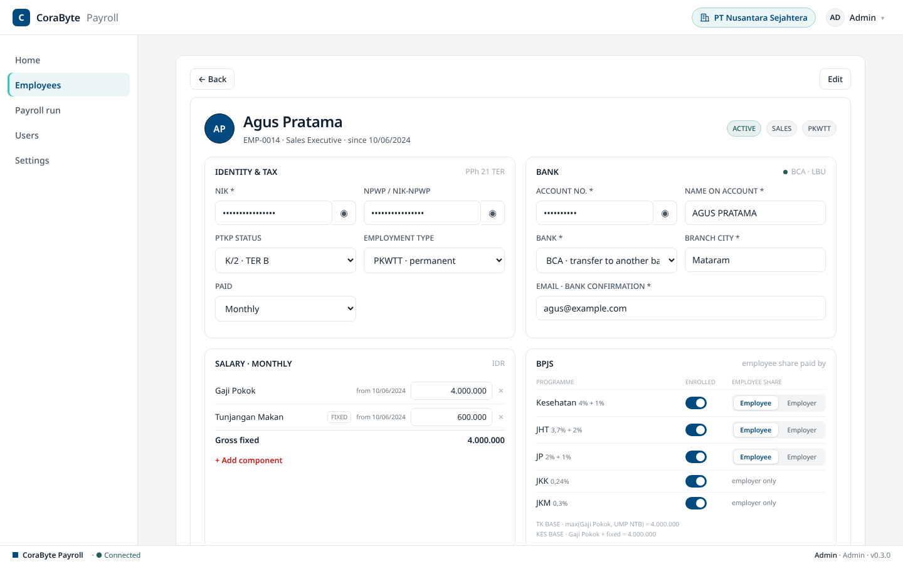 |
| **Employees.** Search, filter and add employees. | **Employee.** Tax identity, bank, salary components, BPJS. |
| 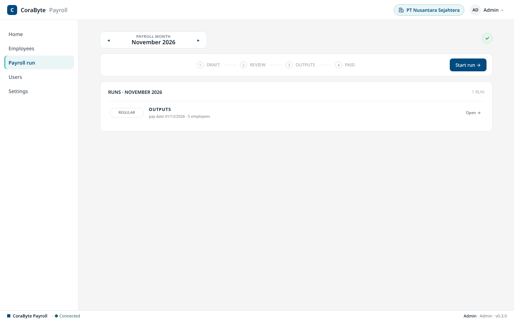 | 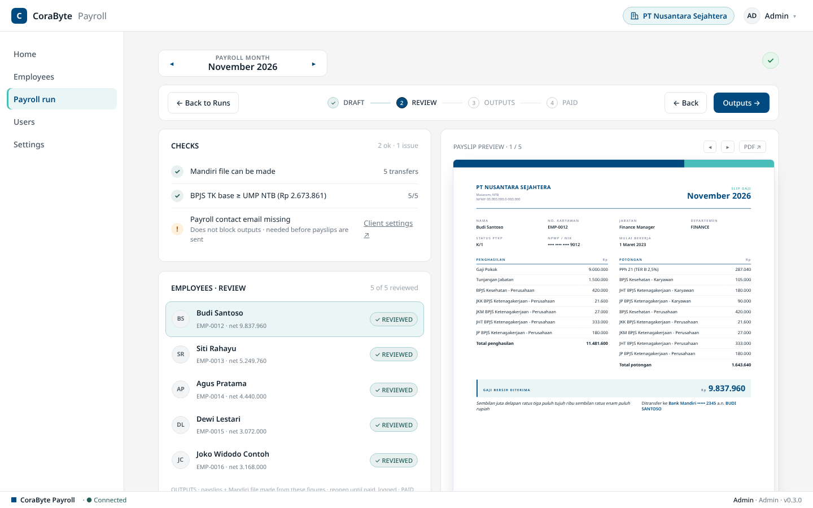 |
| **Payroll run.** Pick the month, start or open a run. | **Review.** Checks, per-employee sign-off, payslip preview. |
| 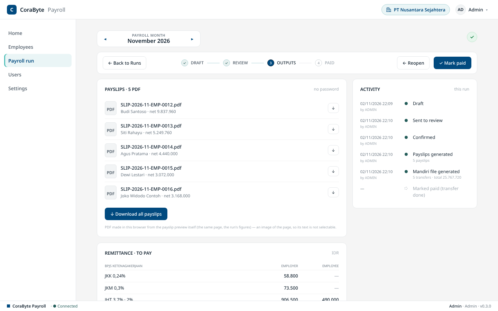 | 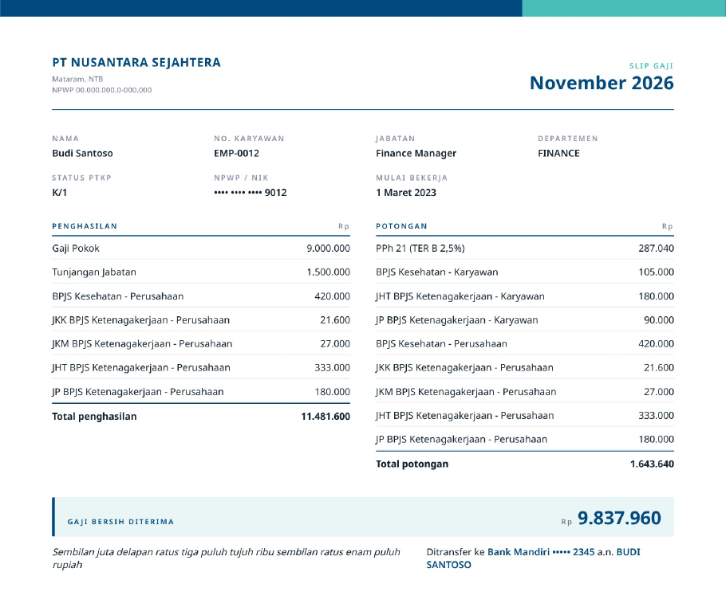 |
| **Outputs.** Payslip PDFs, remittance, Mandiri CSV, activity log. | **Payslip.** The generated A4 PDF. |
| 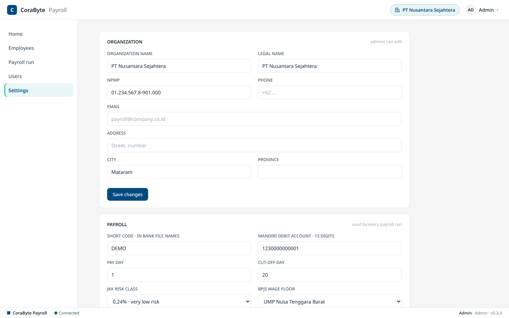 | 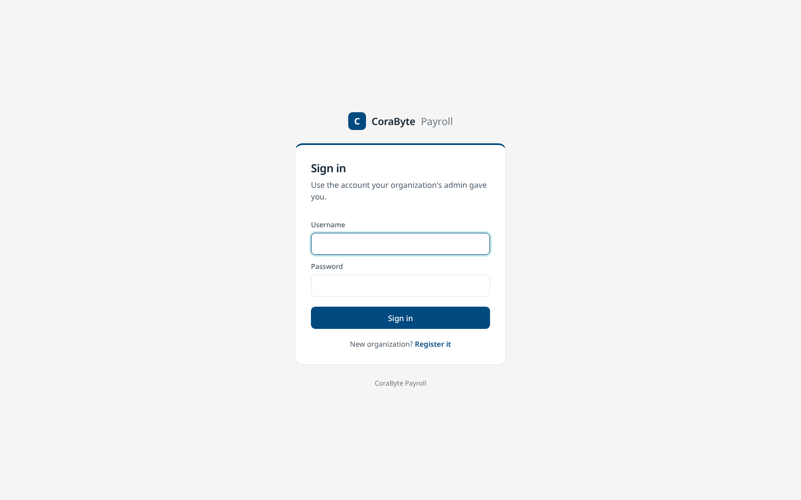 |
| **Settings.** Organisation profile and payroll settings. | **Sign in.** Or register another organisation. |

All names, numbers and companies in the screenshots and demo data are fictional.

## Quick start (Windows)

1. Install Node.js 22.13 or newer (LTS recommended):
   ```cmd
   winget install OpenJS.NodeJS.LTS
   ```
2. Double-click **`start.bat`**. The browser opens at <http://localhost:8080/>.
3. First run: register your organisation. You become its admin.
4. Optional, to explore with fictional data, stop the app, then run the following and sign in as
   `demo` / `demo12345`:
   ```cmd
   npm run seed:demo
   ```

Any OS: `npm start`, then open <http://localhost:8080/>.

There is **no `npm install` step**: the app has zero dependencies.

## Features

| Area | What it does |
|---|---|
| Organisations | Multi-tenant: one organisation = one employer. Self-service registration, isolated data, its name shown in the header. |
| Home | Dashboard: active employees, this month's payroll status, latest net pay and employer cost, recent runs, setup checklist. |
| Settings | Organisation profile (name, NPWP, address), payroll settings (short code, Mandiri debit account, pay/cut-off day, JKK class, BPJS floor), departments & positions. |
| Sign-in | Username + password, sessions in HTTP-only cookies. Roles per organisation: **admin**, **member**. |
| Employees | Identity & tax (NIK, NPWP, PTKP, PKWT/PKWTT), bank account, salary components with effective dates, BPJS enrolment, monthly or daily pay. |
| Payroll run | Draft → Review → Outputs → Paid. Variable pay and days worked; per-line review; paid runs are frozen. Regular and THR runs. |
| Calculation | Server-side: gross, BPJS (employee/employer shares, floors and caps), PPh 21 TER monthly/daily, Pasal 17 year-end, THR. |
| Outputs | Payslip PDFs (one or all), remittance summary PDF, Mandiri "Format Lama" CSV, activity log. |
| Users | Admins add users to their organisation, change roles, reset passwords, deactivate accounts. |

## Configuration

Copy `.env.example` to `.env` to change a setting. Without `.env` the defaults apply.

| Variable | Default | Meaning |
|---|---|---|
| `PORT` | `8080` | HTTP port. |
| `HOST` | `127.0.0.1` | `127.0.0.1` = this computer only. `0.0.0.0` = other PCs on the LAN can connect. |
| `DB_FILE` | see below | Path to the SQLite file. |
| `SESSION_TTL_HOURS` | `12` | How long a sign-in lasts. |
| `ALLOW_SIGNUP` | `1` | `1` = anyone who can reach the server may register a new organisation. `0` = only the first one (on a new installation). |
| `SEED_DEMO` | `0` | `1` = every newly registered organisation starts with the demo data. |

**Where the data lives.** By default the database is kept **outside the project folder**:

- Windows: `%LOCALAPPDATA%\CoraByte Payroll\payroll.db`
- macOS/Linux: `~/.corabyte-payroll/payroll.db`

This keeps a synced folder (Google Drive, OneDrive) from copying a half-written database.
The exact path is printed when the app starts.

## Scripts

| Command | Purpose |
|---|---|
| `npm start` | Start the app. |
| `npm run dev` | Start with auto-restart on file changes. |
| `npm test` | Run the test suite (Node's built-in test runner). |
| `npm run seed:demo` | Create the organisation "Demo Consulting" with fictional data (sign in as `demo` / `demo12345`). With `-- --org "<name>"`: add the demo data to that organisation instead. |
| `npm run user:create -- <username> "<name>" <admin\|member> [--org "<name>"]` | Create a user from the terminal, e.g. when an admin password is lost. |
| `npm run db:backup [-- <folder>]` | Write a consistent copy of the database (safe while running). Default folder: `backups/`. |

## Project structure

```
corabyte-payroll/
├── public/                    Frontend (plain JS, no build step)
│   ├── index.html             App page (requires a session)
│   ├── login.html             Sign-in and organisation registration
│   ├── css/                   ui-kit.css → app.css → theme.css, fonts.css, login.css
│   ├── js/
│   │   ├── core/              config, store (data access), spine (app shell), combo
│   │   ├── lib/               payslip, PDF export, Mandiri CSV
│   │   ├── screens/           home (dashboard), employees, run, outputs, users, settings
│   │   └── login.js
│   └── vendor/                html2canvas, jsPDF, fonts (self-hosted)
├── src/                       Backend (Node.js, no dependencies)
│   ├── server.js              Entry point
│   ├── app.js                 Wires database, services and routes
│   ├── config.js              Settings from environment / .env
│   ├── http/                  Router, request parsing, responses, static files
│   ├── routes/                auth, payroll (store, calc, clients), users
│   ├── services/              Business rules: store, auth, users, organisations, clients
│   ├── calc/                  Payroll engine (pure), its self-test, the calc service
│   └── db/                    Connection, schema.sql, seed, reference rates
├── docs/screenshots/          Images used in this README
├── scripts/                   CLI: create user, seed demo, backup
├── test/                      node:test suites
├── start.bat                  Windows launcher
└── .env.example
```

## How it works

```
Browser ──POST /api/store {op, collection, key, value}──▶ store-service ──▶ SQLite
        ──POST /api/calc  {action, run_id}────────────▶ calc ──(same store)──┘
```

- **One gate for every write.** Both the screens and the calculation go through
  `store-service.js`, which enforces: optimistic locking (`rev`), the run status flow,
  "outputs only when every line is reviewed", one live run per client/month/type,
  paid = frozen, admin-only deletes, and the activity log.
- **The calculation runs on the server.** `src/calc/engine.js` is pure and has a
  self-test (`npm test`, and on the run screen).
- **Data model.** `organizations` is the tenant table; one organisation is one employer. In the
  payroll data the employer is a "client" record (`primary_client_id`); the model supports several
  clients per organisation later, the UI uses one. Users belong to one organisation.
  Payroll data is stored as JSON documents keyed by `(org_id, collection, id)` (`documents` table),
  and the repository only ever opens one organisation at a time. See `src/db/schema.sql`.
  A v0.1 database is upgraded automatically on start: its data moves into one organisation
  ("My organization"), which an admin can rename under Settings.
- **Reference rates** (BPJS, JKK, minimum wage, PTKP, TER, Pasal 17) are seeded from
  `src/db/reference-data.json` into each new organisation. To change a rate, add a row
  with a new `effective_from` and close the old one with `effective_to`.

## API

All endpoints take and return JSON. Errors are `text/plain` sentences meant for the user.

| Method | Path | Notes |
|---|---|---|
| GET | `/api/auth/state` | `{ needsSetup, allowSignup, user }` (public) |
| POST | `/api/auth/register` | `{ org_name, name, username, password }`: new organisation and its admin (public; see `ALLOW_SIGNUP`) |
| POST | `/api/auth/login`, `/api/auth/logout` | (public) |
| GET | `/api/me` | Current user and organisation |
| POST | `/api/me/password` | `{ current, next }` |
| POST | `/api/store` | `{ op: list\|get\|save\|del, collection, key, value }` |
| POST | `/api/calc` | `{ action: compute\|restart\|review\|selftest, … }` |
| POST / PUT | `/api/clients`, `/api/clients/:id` | Client identity, departments & positions |
| POST | `/api/clients/:id/archive` | Admin |
| GET / POST / PUT | `/api/users`, `/api/users/:id` | Admin; users of the own organisation |
| GET / PUT | `/api/org` | The organisation profile (PUT: admin) |
| PUT | `/api/org/structure` | Short code, departments & positions (admin) |
| GET | `/api/health` | (public) |

## Security notes

- Passwords: scrypt with a per-user salt. Sessions: random 256-bit tokens; only their
  SHA-256 is stored. Cookies are `HttpOnly; SameSite=Lax`.
- Cross-site POSTs are refused (Origin check). Ten failed sign-ins lock a username for 15 minutes.
- By default the server listens on `127.0.0.1` only. Before exposing it on a network,
  put it behind HTTPS (e.g. a reverse proxy) and set `HOST=0.0.0.0`.
- NIK, NPWP and account numbers are masked in the UI and never logged.

## Known limitations (MVP)

- Payslip PDFs are images of the page (text not selectable); no ZIP download yet.
- No email sending; files are downloaded and sent by hand.
- Mandiri is the only bank file format.
- Internal code still uses the `GKI` JavaScript namespace and `gki-*`/`pr-*` CSS
  class prefixes inherited from the prototype; renaming them is planned.

## License

Proprietary — © CoraByte. All rights reserved.
Bundled third-party files keep their own licenses: html2canvas and jsPDF (MIT),
Inter and IBM Plex fonts (SIL Open Font License).
